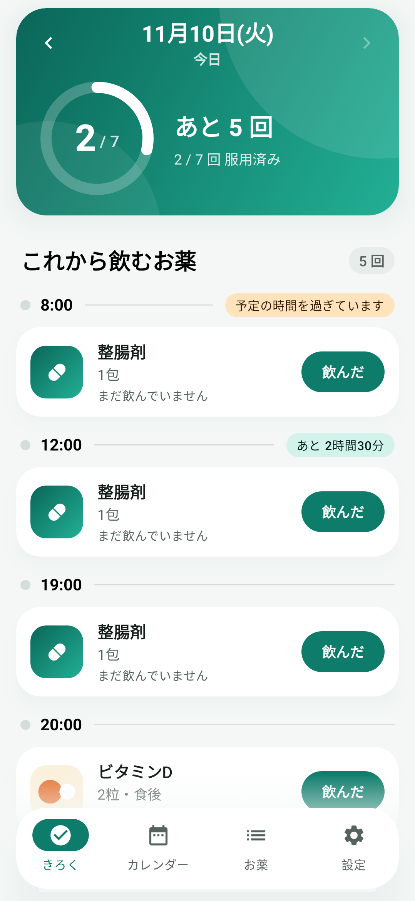
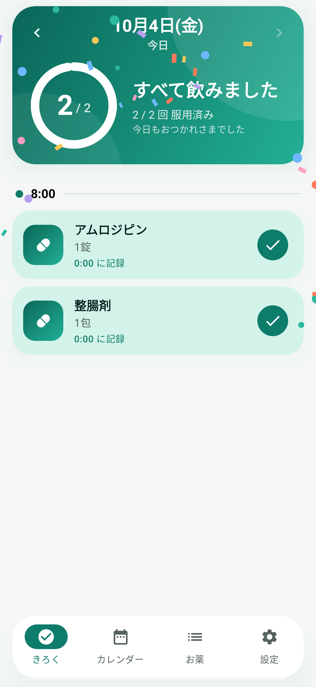
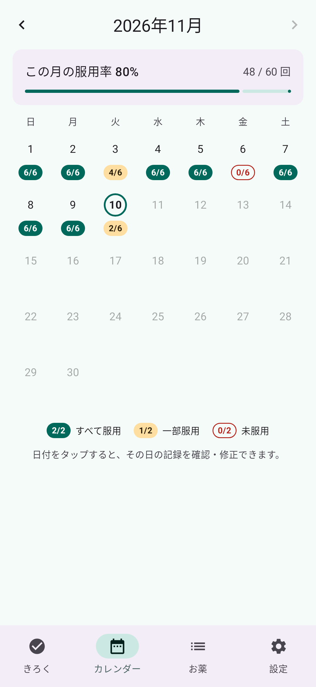
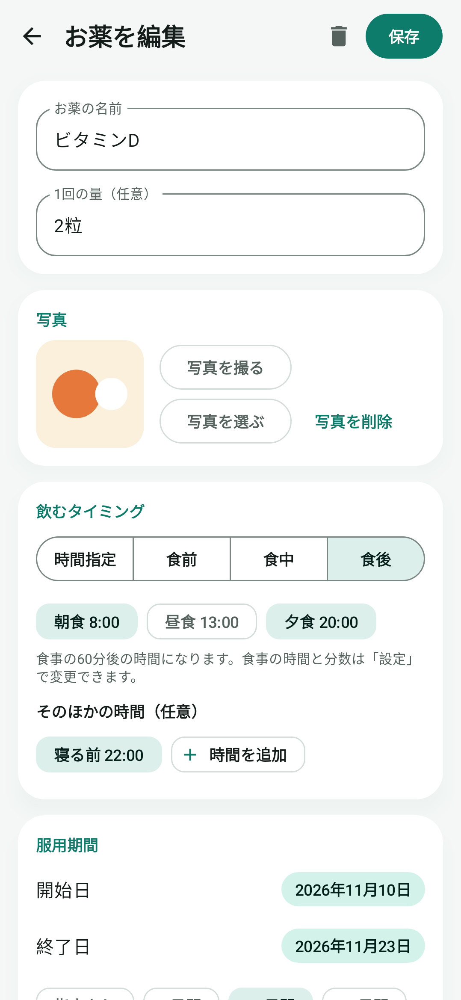
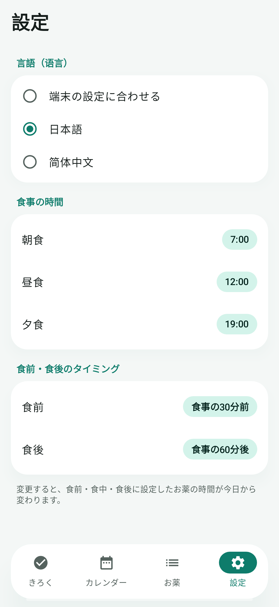

# おくすり記録

お薬を飲んだかどうかを記録する Android アプリです。日本語と簡体字中国語で使えます。

[English](#english) ・ [中文](#中文)

<p>
  
  
  
  
  
</p>

## できること

- **お薬の登録** — 名前、1回の量、写真、飲むタイミング、服用期間、メモ
  - **写真** — カメラで撮るか、端末の写真から選んで添付。きろく画面でタップすると拡大表示
  - **飲むタイミング** — 時間指定（朝・昼・夜・寝る前、または任意の時刻）か、食前・食中・食後。
    食前・食中・食後は朝食・昼食・夕食から選び、食事の時間から自動で時刻を決める
    （初期値: 食前は食事の30分前、食後は食事の60分後）
  - **服用期間** — 開始日と終了日を選択（「7日間」「14日間」「30日間」からも指定可能）。
    終了日を過ぎると、きろくと通知に出なくなる。開始日は先の日付にも、さかのぼった日付にもできる
- **きろく** — これから飲むお薬を時間順に一番上へ、飲んだお薬はその下に表示。
  時間を過ぎた回には印が付き、次の回には「あと◯時間◯分」と出る。「飲んだ」を押すと記録した時刻つきで保存。
  記録済みをタップすると確認のうえ取り消し。過去の日にさかのぼって確認・修正も可能
- **カレンダー** — 日ごとの「飲んだ回数/予定回数」と、月の服用率を表示
- **リマインダー** — 飲む時間に通知。通知の「飲んだ」ボタンからそのまま記録可能（お薬ごとにオン/オフ）
- **設定** — 表示言語（日本語 / 简体中文 / 端末の設定に合わせる）、食事の時間、食前・食後の分数
- **見た目と動き** — 進み具合の円グラフ、記録したときのチェックの動き、その日の分をすべて飲んだときの紙吹雪、
  画面の切り替えのアニメーション。端末でアニメーションを無効にしている場合、紙吹雪は出しません

データは端末内（Room / SQLite）にのみ保存し、外部には送信しません。

## インストール

[Releases](https://github.com/Orangeade0/orange_kusuri_kiroku/releases) から最新の APK をダウンロードして、
Android 8.0 以上の端末にインストールします。

## ビルド

Android Studio で開くか、Android SDK を用意して次を実行します。

```bash
./gradlew :app:assembleDebug
```

APK は `app/build/outputs/apk/debug/app-debug.apk` に出力されます。

```bash
./gradlew :app:testDebugUnitTest
```

テスト（ロジック・DB・通知・画面操作）を実行し、各画面の画像を
`app/build/outputs/roborazzi/` に書き出します。

リリース用の APK は、署名鍵の場所とパスワードをプロジェクト直下の `keystore.properties` に書いてから作ります
（このファイルと鍵は Git に入れません）。

```
storeFile=鍵ファイルの場所
storePassword=パスワード
keyAlias=鍵のエイリアス
keyPassword=パスワード
```

```bash
./gradlew :app:assembleRelease
```

## 構成

| 場所 | 内容 |
| --- | --- |
| `data/` | Room のエンティティ・DAO・移行処理、`MedRepository`、設定（`SettingsStore`）、写真（`ImageStore`） |
| `domain/Schedule.kt` | その日の予定と記録の組み立て、次の通知時刻の計算 |
| `reminder/` | AlarmManager によるリマインダーと通知 |
| `ui/` | Jetpack Compose (Material 3) の画面と `AppViewModel` |

- 対応 OS: Android 8.0 (API 26) 以上
- 飲む時間を変更すると、過去の記録が変わらないよう、その日から新しい予定に切り替わります。
  設定で食事の時間や食前・食後の分数を変えたときも同じです。
- 文言は `res/values/strings.xml`（日本語）と `res/values-zh/strings.xml`（簡体字中国語）にあります。
- 写真は縮小してアプリ内に保存します。データベースの構造は `app/schemas/` に版ごとに記録しています。
- 削除したお薬は今日以降の予定から外れ、過去の記録はカレンダーに残ります。
- Android 14 以降では「アラームとリマインダー」の許可がないと通知が数分遅れることがあります
  （お薬タブに案内が表示されます）。

## ご注意

このアプリは服薬の記録を助けるためのもので、医療上の助言をするものではありません。
お薬の飲み方は、医師・薬剤師の指示に従ってください。

## ライセンス

[Apache License 2.0](LICENSE)

---

## English

**Okusuri Kiroku** ("medication log") is an Android app for recording whether you have taken your medication.
The interface is available in Japanese and Simplified Chinese.

- Register medications with a name, dose, photo, schedule and note
- Schedule by clock time, or before / with / after breakfast, lunch and dinner
  (defaults: 30 minutes before a meal, 60 minutes after; meal times and offsets are adjustable)
- Optional start and end dates for a course of medication
- Mark each dose as taken, review past days on a calendar, and see the monthly adherence rate
- Reminder notifications with a "taken" action
- All data stays on the device; nothing is sent anywhere

Build with `./gradlew :app:assembleDebug` (Android 8.0 / API 26 or later).
This app is a record-keeping aid, not medical advice. Licensed under the [Apache License 2.0](LICENSE).

## 中文

**服药记录**是一款用来记录是否已服药的 Android 应用，支持日语和简体中文界面。

- 添加药物：名称、每次用量、照片、服药时间、备注
- 可以指定具体时间，也可以设为早餐、午餐、晚餐的饭前、饭中、饭后
  （默认：饭前为用餐前30分钟，饭后为用餐后60分钟；用餐时间和分钟数可以修改）
- 可以设定服药期间（开始日期和结束日期）
- 记录每次服药，在日历中查看以往的记录和每月服药率
- 到时间时发送通知，可以直接在通知中记录
- 所有数据只保存在手机中，不会发送到任何地方

构建：`./gradlew :app:assembleDebug`（需要 Android 8.0 / API 26 以上）。
本应用仅用于辅助记录，不提供医疗建议。许可证：[Apache License 2.0](LICENSE)。
